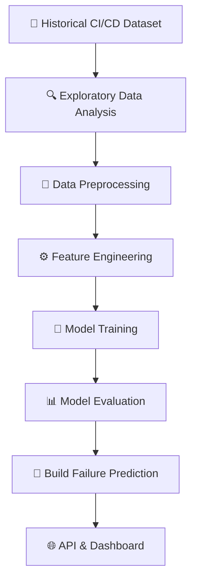

# 🚀 CI/CD Build Failure Prediction Using Machine Learning

<p align="center">
  
  
  
</p>

<p align="center">
  <b>🤖 Predicting CI/CD Pipeline Build Failures Before Execution Using Machine Learning</b>
</p>

---

## 🌟 About The Project

Modern software development relies heavily on **Continuous Integration and Continuous Deployment (CI/CD)** pipelines to automate software building, testing, and delivery.

However, unexpected build failures can interrupt development workflows, waste valuable engineering time, and reduce development productivity.

This project aims to develop an intelligent **Machine Learning-based prediction system** that analyses historical CI/CD build data, identifies failure-related patterns, and predicts the likelihood of future build failures before execution.

🎯 Our goal is to make DevOps workflows smarter through predictive analytics and machine learning.

## 🎯 Project Objectives

- 🔍 Analyse historical CI/CD pipeline build data.
- 📊 Explore software development metrics and build characteristics.
- 🧠 Identify important features associated with build failures.
- 🤖 Develop machine learning classification models.
- 📈 Evaluate predictive performance using appropriate evaluation metrics.
- ⚡ Predict potential CI/CD build failures before execution.
- 🛠️ Develop a practical predictive system for DevOps environments.

## 💡 Key Features

| Feature | Description |
|---|---|
| 📂 Data Analysis | Explore and understand historical CI/CD build data |
| 🧹 Data Preprocessing | Clean, transform, and prepare the dataset |
| ⚙️ Feature Engineering | Extract meaningful predictive features |
| 🤖 ML Classification | Train models to classify build outcomes |
| 📊 Model Evaluation | Compare models using performance metrics |
| 🔮 Failure Prediction | Estimate the likelihood of build failure |
| 🌐 Prediction API | Provide predictions through a backend API |
| 📈 Dashboard | Visualise prediction results and model insights |

## 🧰 Technology Stack

### 🐍 Programming Language
- Python

### 📊 Data Science & Machine Learning
- Pandas
- NumPy
- Scikit-learn
- Matplotlib
- Seaborn

### 🗄️ Data Processing
- DuckDB
- PyArrow
- Parquet

### ☁️ Development Environment
- Google Colab
- Google Drive
- Jupyter Notebook

### 🌐 Deployment & Integration
- FastAPI
- Streamlit
- GitHub Actions

## 🏗️ Project Workflow



## 📊 Machine Learning Approach

This project is designed as a **Supervised Binary Classification** problem.

| Target | Meaning |
|---|---|
| `0` | ✅ Successful Build |
| `1` | ❌ Failed Build |

### 🤖 Planned Algorithms

- Logistic Regression
- Decision Tree
- Random Forest
- Gradient Boosting

### 📈 Evaluation Metrics

- Accuracy
- Precision
- Recall
- F1-Score
- Confusion Matrix
- ROC-AUC
- PR-AUC

> ⚠️ Special attention will be given to data leakage and chronological data splitting to ensure realistic evaluation of future build predictions.

## 📁 Project Structure

```text
ci-cd-build-failure-prediction/
│
├── 📂 dataset/
│   ├── raw/
│   └── processed/
│
├── 📂 notebooks/
│   ├── 01_data_collection.ipynb
│   ├── 02_data_analysis.ipynb
│   ├── 03_preprocessing.ipynb
│   ├── 04_model_training.ipynb
│   └── 05_model_evaluation.ipynb
│
├── 📂 src/
│   ├── data_collection/
│   ├── preprocessing/
│   ├── features/
│   └── models/
│
├── 📂 backend/
│   ├── main.py
│   └── schemas.py
│
├── 📂 dashboard/
│   └── app.py
│
├── 📂 models/
│
├── 📂 tests/
│
├── 📂 .github/
│   └── workflows/
│
├── requirements.txt
├── README.md
└── .gitignore
```

*The structure above is the planned project structure and will evolve as development progresses.*

## 📅 Development Roadmap

| Phase | Activities | Status |
|---|---|---|
| 🟢 Phase 01 | Project Understanding & Dataset Inspection | In Progress |
| 🔵 Phase 02 | Exploratory Data Analysis | In Progress |
| ⚪ Phase 03 | Data Cleaning & Preprocessing | Planned |
| ⚪ Phase 04 | Feature Engineering | Planned |
| ⚪ Phase 05 | Machine Learning Model Development | Planned |
| ⚪ Phase 06 | Model Evaluation & Optimization | Planned |
| ⚪ Phase 07 | API & Dashboard Development | Planned |
| ⚪ Phase 08 | Testing & Deployment | Planned |

## 📚 Learning Outcomes

Through this project, we aim to gain practical experience in:

- Machine Learning and Predictive Analytics.
- Real-world dataset analysis.
- Software engineering metrics.
- CI/CD pipeline concepts.
- Feature engineering and model evaluation.
- Building and deploying ML-powered applications.

## 🔬 Research Focus

The central research question is:

**Can historical software development metrics and CI/CD build information be used to predict future build failures before execution?**

The project investigates the relationship between repository characteristics, code changes, development activity, and build outcomes.

## 👨‍💻 Author

**Developed as a Machine Learning Research Project**

📌 Domain: Machine Learning & DevOps  
🎯 Focus: Predictive Analytics for CI/CD Pipelines

---

<p align="center">
  ⭐ If you find this project interesting, consider giving this repository a star!
</p>

<p align="center">
  <b>🚀 Building Smarter DevOps with Machine Learning!</b>
</p>
